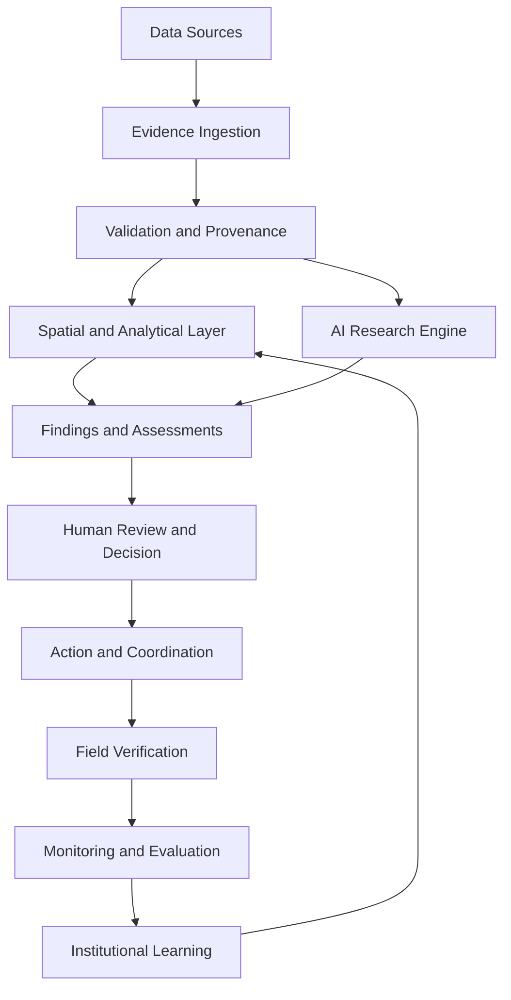

# Atlas Resilience Intelligence

### Atlas Aegis · A Living Intelligence System for a More Resilient Civilization

**From observation to understanding. From intelligence to action. From action to verified impact.**

Atlas Resilience Intelligence is an applied AI and geospatial intelligence initiative by **Atlas Sanctum**, focused on helping institutions understand infrastructure and environmental risks, prioritise interventions, coordinate action, and measure real-world outcomes.

The platform aims to transform fragmented data, geographic information, research, and field observations into trustworthy, actionable intelligence.

Our first area of focus is infrastructure and climate resilience in Kenya, with a practical emphasis on roads, drainage, flood exposure, and place-based decision support.

> **Our mission:** Build intelligence systems that turn complexity into trustworthy decisions and decisions into measurable action.

**Project status:** In development. The architecture and roadmap describe the intended system; individual capabilities should be considered implemented only when verified in the codebase and tested against real or clearly labelled demonstration data.

---

## Table of Contents

- [Vision](#vision)
- [The Problem](#the-problem)
- [Our Approach](#our-approach)
- [Core Capabilities](#core-capabilities)
- [Initial Use Case](#initial-use-case)
- [System Architecture](#system-architecture)
- [Technology Stack](#technology-stack)
- [Scientific and Ethical Principles](#scientific-and-ethical-principles)
- [Development Roadmap](#development-roadmap)
- [Research Agenda](#research-agenda)
- [Getting Started](#getting-started)
- [Contributing](#contributing)
- [About Atlas Sanctum](#about-atlas-sanctum)
- [License](#license)

---

## Vision

We envision a world in which institutions can reason about complex systems with greater clarity, anticipate vulnerabilities, deploy resources more effectively, and learn from the consequences of their decisions.

Infrastructure and environmental challenges rarely exist in isolation. Roads connect communities to markets. Drainage affects transportation and public health. Rainfall interacts with terrain, land use, drainage capacity, and the condition of built infrastructure. Decisions made in one location can affect entire networks of services and livelihoods.

Yet the evidence needed to understand these relationships is often fragmented across spreadsheets, maps, research papers, reports, databases, and local knowledge.

Atlas Resilience Intelligence aims to connect these sources within a unified analytical and operational environment.

### The Atlas philosophy

- **Atlas — Connection:** Understand relationships across places, assets, evidence, and institutions.
- **Sanctum — Stewardship:** Protect information, respect human agency, and pursue responsible innovation.
- **Aegis — Resilience:** Identify vulnerabilities, investigate potential failures, and support risk-informed action.
- **Observatory — Evidence:** Distinguish observations, hypotheses, model outputs, and verified findings.
- **Command Bridge — Execution:** Translate insights into accountable decisions, coordinated interventions, and measurable outcomes.

Our vision is ambitious. Our engineering approach is grounded in evidence, incremental delivery, and measurable utility.

## The Problem

Infrastructure and climate-resilience decisions are frequently constrained by five related challenges.

**Fragmented evidence**

Important information may be distributed across incompatible datasets, static reports, spreadsheets, geographic systems, and field observations.

**Limited spatial context**

Decision-makers may struggle to connect reported problems to specific assets, surrounding conditions, and neighbouring systems.

**Opaque prioritisation**

Risks and interventions can be difficult to compare when scoring methods, assumptions, uncertainties, and data limitations are unclear.

**Disconnected execution**

Analytical findings do not automatically become approved decisions, assigned tasks, completed interventions, or verified outcomes.

**Weak feedback loops**

Without structured follow-up data, institutions struggle to determine whether an intervention worked, whether an assessment was accurate, or what should change next time.

Atlas is being designed to address these gaps through evidence-grounded intelligence and an integrated decision workflow.

## Our Approach

Atlas follows a continuous operational cycle:

**Observe → Understand → Decide → Coordinate → Verify → Learn**

| Stage | Purpose | Intended output |
|---|---|---|
| Observe | Collect and validate information | Structured evidence and source records |
| Understand | Connect evidence to place and context | Findings, relationships, and uncertainty assessments |
| Decide | Compare risks and possible responses | Transparent priorities and decision briefs |
| Coordinate | Turn approved decisions into work | Assigned actions, responsibilities, and timelines |
| Verify | Evaluate execution and outcomes | Follow-up observations and verification records |
| Learn | Improve future analyses and decisions | Documented lessons and updated methods |

The platform is intended to combine conventional geospatial and statistical methods with AI-assisted research, document analysis, and workflow automation.

AI is one component of the system—not a substitute for reliable data, scientific methods, field verification, or human accountability.

## Core Capabilities

The following capabilities define the intended product scope. Their availability depends on implementation and validation.

### 1. Living Atlas — Geospatial Intelligence

A geographic workspace for exploring infrastructure, environmental conditions, observations, and potential risks.

Planned capabilities:

- Interactive maps and spatial filtering.
- Infrastructure and asset inventories.
- Georeferenced field observations.
- Administrative boundaries and relevant geographic layers.
- Evidence-linked issue markers.
- Temporal comparisons when suitable historical data exists.
- Data provenance and freshness indicators.
- Identification of spatial data gaps.

### 2. Observatory — Evidence Management

A structured evidence system that connects analytical conclusions to their supporting sources.

Planned capabilities:

- Document and dataset ingestion.
- CSV, Excel, and PDF processing where supported.
- Source metadata and provenance tracking.
- Data-quality validation.
- Missing-value and inconsistency detection.
- Traceable claims and findings.
- Contradictory evidence and unresolved questions.
- Versioned observations and assessments.

### 3. Aegis — Risk and Resilience Intelligence

An analytical layer for evaluating infrastructure and environmental risks with transparent assumptions.

Planned capabilities:

- Hazard, exposure, and vulnerability screening where data permits.
- Infrastructure-condition assessment.
- Explainable risk-ranking methods.
- Scenario and intervention comparisons.
- Identification of critical information gaps.
- Uncertainty-aware prioritisation.
- Reproducible analysis and sensitivity testing.

Risk scores must have an explicit methodology. The platform must not imply that a complete risk assessment is possible when critical data is missing.

### 4. Intelligence Engine — AI-Assisted Research

A model-assisted environment for interpreting evidence and reducing repetitive analytical work.

Planned capabilities:

- Research and technical-document summarisation.
- Structured information extraction.
- Source-linked analytical drafting.
- Cross-document comparisons.
- Identification of contradictions and missing evidence.
- Generation of research questions and inspection checklists.
- Drafting of decision briefs and reports.
- Evaluation of model outputs against reviewed examples.

AI-generated statements must be distinguishable from source facts, and material claims must be traceable to evidence wherever possible.

### 5. Command Bridge — Decisions and Action

A workflow for connecting analytical findings to practical work.

Planned capabilities:

- Risk registers and intervention priorities.
- Human review and approval.
- Task assignment and action tracking.
- Ownership, deadlines, and status histories.
- Intervention documentation.
- Preliminary cost and scenario estimates.
- Exportable reports and decision briefs.

The platform should distinguish proposed actions from approved decisions, assigned tasks, completed work, and verified outcomes.

### 6. Impact Ledger — Monitoring and Learning

A structured record of interventions and the evidence used to evaluate them.

Planned capabilities:

- Baseline records.
- Monitoring indicators.
- Follow-up observations.
- Planned-versus-completed comparisons.
- Outcome verification.
- Historical assessment versions.
- Error and uncertainty analysis.
- Evaluation of model performance over time.

Reported impact must be based on explicit measurement methods. Temporal association alone must not be presented as proof of causation.

---

## Initial Use Case

### Infrastructure and Climate Resilience in Kenya

Atlas begins with a deliberately bounded problem: helping a real organisation investigate and prioritise road, drainage, flood-exposure, or related infrastructure concerns in a selected Kenyan study area.

Potential study areas include parts of Nairobi and Nakuru County. The final selection should depend on customer access, available data, field-validation opportunities, and the ability to deliver a useful outcome.

A pilot workflow might:

1. Import authorised infrastructure records, project documents, and available geographic datasets.
2. Validate their quality, spatial coverage, and limitations.
3. Connect reported issues to relevant locations and assets.
4. Produce an explainable list of issues requiring investigation or intervention.
5. Identify uncertainties and recommend additional field checks.
6. Prepare a decision brief for review by the responsible institution.
7. Record approved actions and subsequent observations.
8. Compare the observed results against the documented baseline.

**The objective is not to predict everything. It is to help a specific user make one consequential decision better.**

### Intended users

- Infrastructure engineering and consulting firms.
- Climate-adaptation and environmental organisations.
- County technical teams and public-sector project groups.
- Universities and applied research teams.
- Water, transportation, and utility operators.
- Development programmes requiring stronger monitoring and verification.

These are target user groups, not claims of existing customers or partnerships.

---

## System Architecture

Atlas is intended to follow a modular architecture that separates source data, analytical methods, AI inference, decisions, and outcome verification.

### Architectural components

| Component | Responsibility |
|---|---|
| Web application | User interface, maps, dashboards, and analytical workspaces |
| Application API | Authentication, validation, business rules, and controlled operations |
| Data platform | Persistence, relational records, spatial data, and project history |
| Evidence services | Document ingestion, metadata, source tracking, and data-quality checks |
| Analytical services | Geospatial processing, statistics, risk assessment, and scenario analysis |
| AI integration layer | Model access, structured outputs, tool restrictions, and evaluation |
| Decision workflow | Reviews, approvals, assignments, and status transitions |
| Verification layer | Baselines, follow-up evidence, indicators, and outcome analysis |
| Security and audit | Access policies, tenant isolation, logging, and accountability |

### Proposed data model

The domain model is organised around the following entities:

- `Organisation`
- `Project`
- `Place`
- `Asset`
- `Source`
- `Observation`
- `Finding`
- `Assessment`
- `Scenario`
- `Decision`
- `Action`
- `Verification`
- `Indicator`
- `AuditEvent`

Each relevant record should have stable identifiers, timestamps, ownership, relationships, and appropriate access controls. Important findings should preserve their source references and validation status.

---

## Technology Stack

The initial implementation can use the following technologies where compatible with the existing repository.

| Layer | Proposed technology | Purpose |
|---|---|---|
| Frontend | React, TypeScript, Vite | Interactive application |
| Mapping | MapLibre GL JS or a suitable GIS library | Geospatial visualisation |
| Spatial database | PostgreSQL, PostGIS | Spatial data and queries |
| Application backend | Existing server-side framework or secure Supabase services | APIs and application logic |
| Authentication | Supabase Auth or existing identity provider | Identity and access control |
| File storage | Supabase Storage or compatible object storage | Authorised documents and attachments |
| AI integration | Provider-agnostic model gateway | Model flexibility and evaluation |
| Analysis | Python, GeoPandas, Shapely, and suitable statistical libraries | Geospatial and scientific processing |
| Testing | Framework-specific unit, integration, and end-to-end tests | Correctness and reliability |
| Deployment | Existing compatible hosting and managed infrastructure | Delivery and operation |

This is a proposed stack, not a claim that every component is already configured.

Technology choices should be based on actual repository conditions, security requirements, deployment constraints, and customer needs. Avoid introducing unnecessary services or duplicating existing functionality.

---

## Scientific and Ethical Principles

Atlas aims to make its intelligence reproducible, transparent, and accountable.

### Evidence before assertion

Material findings should identify their supporting sources, methods, and limitations.

### Uncertainty before false precision

When data is incomplete or unreliable, communicate the uncertainty rather than inventing confidence.

### Human accountability

AI can assist with research and recommendations, but authorised people remain responsible for consequential decisions.

### Reproducibility

Version analytical methods, record assumptions, and preserve enough information to reconstruct important assessments.

### Local context and community knowledge

Incorporate relevant local evidence and knowledge with appropriate attribution, validation, consent, and data governance.

### Privacy and security

Apply least-privilege access, appropriate retention policies, secure secret management, and organisational data isolation.

### Measurable impact

Distinguish simulated outputs, modelled estimates, reported observations, and independently verified outcomes.

### Responsible AI

Treat imported documents and external content as untrusted input. Constrain tools and agent permissions, validate generated outputs, and test failure modes.

Atlas is designed as a decision-support system. It does not replace professional engineering judgement, official emergency services, or responsible institutional authority.

---

## Development Roadmap

Development should proceed through complete, testable slices rather than superficial implementations of every planned feature.

| Phase | Focus | Exit criterion |
|---|---|---|
| 1. Foundation | Repository, authentication, projects, data model | A secure, persistent project workspace |
| 2. Evidence | File ingestion, validation, provenance | A dataset can be imported and its quality inspected |
| 3. Spatial intelligence | Interactive map and evidence-linked records | A user can investigate actual or labelled demo locations |
| 4. Risk assessment | Transparent scoring and uncertainty | A user can reproduce and explain an assessment |
| 5. Decision workflow | Review, approval, task assignment | An approved action can be tracked across sessions |
| 6. AI research | Grounded extraction and analytical drafting | Model outputs are evaluated and linked to evidence |
| 7. Verification | Baselines, follow-up, outcome comparison | A documented intervention can be evaluated against evidence |
| 8. Deployment | Security checks, tests, documentation | The application can be deployed and operated reliably |

### Definition of done

A feature is not considered complete merely because its interface exists.

It should have appropriate persistence, validation, permissions, useful failure states, testing, documentation, and demonstrated behaviour.

Demonstration data must be clearly labelled. Live integrations must be verified. Unsupported outputs must not be presented as factual measurements.

---

## Research Agenda

Atlas Sanctum is also a research platform. Its long-term contribution should include methods and findings that can be independently inspected and improved.

Potential research themes include:

- Geospatial machine learning for infrastructure and environmental assessment.
- Rainfall, drainage, and flood-related infrastructure intelligence.
- Data-quality and uncertainty-aware decision support.
- AI-assisted scientific research and evidence extraction.
- Evaluation of agentic AI in complex analytical workflows.
- Human-machine collaboration in institutional decisions.
- Infrastructure resilience indicators and intervention monitoring.
- African data infrastructure and place-based intelligence.
- Impact verification and accountable technology deployment.

Research should state its research questions, data provenance, methods, evaluation metrics, confounders, limitations, and reproducibility requirements.

A functioning product and a scientifically defensible finding are related but distinct achievements. Both matter.

---

## Getting Started

The project is in development, and installation commands depend on the actual repository structure.

### Prerequisites

The proposed development environment may require:

- Node.js and a compatible package manager.
- Python for analytical services.
- PostgreSQL with PostGIS, if spatial persistence is used.
- Configured authentication and storage services.
- API credentials for any enabled external model provider.

### Local development

1. Clone the repository.
2. Inspect the project documentation and package scripts.
3. Install dependencies using the package manager specified by the project.
4. Configure environment variables using a documented example file.
5. Apply database migrations where provided.
6. Start the services according to the repository instructions.
7. Run the available test suite.

Do not commit secrets, production credentials, private datasets, or sensitive customer information.

### Environment configuration

Document required configuration in an `.env.example` file and keep actual credentials in an ignored local environment file or an appropriate secrets manager.

The exact variables should be determined by the implemented services. Never publish production API keys or privileged database credentials.

---

## Contributing

Atlas welcomes contributions that strengthen the reliability, accessibility, reproducibility, and real-world usefulness of the platform.

Potential areas of contribution include:

- Geospatial analysis and data processing.
- Frontend and backend engineering.
- Climate and infrastructure research.
- Statistical evaluation and testing.
- Data-quality and provenance tooling.
- Responsible AI and security.
- Documentation and accessibility.
- Field-validation and monitoring methodologies.

### Contribution principles

1. Prefer a working, tested improvement over a broad but incomplete feature.
2. Document sources, assumptions, and methodological choices.
3. Include tests for analytical logic and important state transitions.
4. Do not submit private or sensitive data without appropriate authorisation.
5. Label synthetic, illustrative, and unverified data.
6. Keep interfaces usable, accessible, and grounded in actual workflows.

Before contributing, inspect the repository's contribution guidelines and open issues if available.

---

## About Atlas Sanctum

**Atlas Sanctum** is a Kenya-rooted technology and research initiative focused on responsible AI, geospatial intelligence, digital infrastructure, environmental resilience, and systems that support sustainable development.

Its broader vision is to build organisations and technologies capable of turning complexity into trustworthy decisions—and decisions into measurable action.

Atlas Resilience Intelligence is one expression of that mission.

We begin with practical problems, evidence-grounded research, and working systems. We aim to expand through validated use cases, responsible partnerships, and demonstrated impact.

---

## License

The project's license has not yet been specified.

Before public distribution, add a `LICENSE` file defining the applicable terms for the code. Data, maps, external datasets, model weights, and other dependencies may carry separate licensing or usage restrictions.

---

## The Principle

> **The mission is not to simulate a better world. It is to help build one, and to prove what actually changed.**

**Atlas Sanctum — Intelligence in service of life.**

**Atlas Aegis — From observation to resilience.**
